# How does source become an agent's context?

AIKit maintains an index and resolves the actor's Project, Profile, Focus and
scope against available sources. SourcePool retrieval, SemanticWiki meaning,
code-index structure, capability descriptions and praxis have distinct owners.
The native knowledge route searches/resolves/reads them with provenance. A
matrix `architecture_refs` or `diagram_refs` relation makes a document
discoverable; it does not establish implementation or silently load its body.

Skill, Method and Methodology share a praxis identity but carry different
description forms. A SkillSet is a selection/package relation, not a combined
body and not an authority grant. Resolve and read the selected revision before
using its practice. ContextResolution describes what was selected and why;
hook/adaptor delivery must separately prove what entered the harness.

The current Wiki operational projection is selected by declared source address.
AIKit rereads its bytes/revision, wraps them as attributed operational context
and delivers through the chosen hook/encounter path. Revision-checked native
correction updates that projection and ledger; it does not rewrite governance.
NOW context uses selected native refs/revisions and hot Redis continuity where
available. Redis is a cache; Central and the independently owned sources remain
authoritative. Saved → selected → emitted → observed use are separate claims.

| Operation | Owner/source | Lifecycle and proof |
| --- | --- | --- |
| `aikit knowledge search/resolve/read/route/explain/history` | AIKit knowledge providers and resolver | Provider authority and warnings retained; missing Wiki child is a failure, not empty knowledge. |
| `aikit praxis read` / resolution | `crates/aikit-core/src/praxis.rs`, `agent_praxis.rs`, `context_resolution.rs` | Identity/revision, form and selected scope; consult `docs/PRAXIS-ARCHITECTURE.md` and `docs/v2/`. |
| `aikit wiki projection read/update` | `crates/aikit-cli/src/wiki_projection.rs` | Exact expected revision, durable correction ledger, next delivery names actual source hash. |
| Native hook and encounter admission | `crates/aikit-adapters/src/hook_sources.rs`, `crates/aikit-cli/src/encounter_service.rs` | Selected source/adaptor receipts; `apply_hook_seam.rs`, `hook_stdout_inject.rs`, `encounter_context_admission.rs`, `now_context_encounter.rs`. |

The initial root Wiki query failed with
`knowledge.wiki_space_missing_child` for `central:wiki:project:Actuation`.
Direct native source reads worked and inspection proceeded after that recorded
faculty failure. A later native search on 1 October succeeds with explicit
warnings: missing `epi` and `legacy` child targets are dropped from the read
index, SourcePool and code search are degraded, the Central product query
reports no `World Central` and falls back to root lineage, and 36 unresolved
targets remain in that primary reading. A product repository is distinct from
the person's World; this warning does not commission a new personal World
named Central. This no longer reports the earlier fatal Actuation failure; it does
not prove every Wiki/World relation repaired. C9 preserves the latest observed
warning, not a designed omission or an empty-knowledge result.

Native `aikit praxis list` and `aikit search architecture-authoring` resolve
the Central practices as revisioned `skill/central/...` capsules. Matrix
praxis links identify those capsules; they do not claim the practice has been
selected or used in a later encounter.

Arrow bases C1–C9 are in [relations.json](relations.json). The existing
[praxis/document programme](../../.wayfinder/maps/agent-praxis-document-world.md)
governs the desired shape; this companion records the inspected delivery cuts.

## Composition, making an agent and prepared context

### Composition and what reaches the agent

AIKit's composition grammar already spans Components, Contracts, providers, contributions, scopes, lifecycle and Surfaces. #158/#53 explicitly extend its application beyond one harness: Herdr, graphical environment and client/UI composition must not be forced into a HarnessComposition-shaped object.

Resolve and explain three separate questions: why source/configuration was selected; where its effects are active; what owns their lifetime. A Project-selected Skill or component can activate for one session only.

Use the shared native composition path to join selected identity/participation, praxis/SkillSets/Methods, Knowledge/Context, model policy/route, harness edition, environment and authority. Methods retain the current Skill/Capability classification. Model/harness choice and runtime environment are coupled by actual required tools, modalities, costs and faculties.

Verify what entered the actual target: generated file, projected configuration, loaded instruction, usable tool and observed enforcement are distinct. Test two sessions in the same Project with different selected skills/context; changing one must not silently mutate the other's active state. Activation now, reconnect, new session and reversible external procedure remain truthful target modes.

Agent and human Surfaces invoke the same native Action handlers and receive the same attributable results within their disclosure scope. “Complete structured access” means complete permitted access, not unrestricted private world capture. Static and richly composable harnesses remain valid; preserve DSH/Pi/other existing evidence and require fresh proof only where changed contracts pressure it.

### Source role, authority, disclosure and precedence

Central's existing Project Context Protocol supplies Ground → World → Praxis → Intent → Context Frame → Return. These are relations, not mandatory directories or an instruction to insert every source into every prompt. In the user's Epi-Logos world, QL-MEF supplies its own native organisation and reflexive readings of this field. The generic O:I relation remains operable without requiring QL fields or an Epi-only Agent.

A resolved source bundle must be attributable to the act that used it. Displaying today's Profile or freshly recomputing ContextResolution does not establish yesterday's effective context. Preserve the historical receipt or source-qualified binding through the existing owner mechanism; investigate the current native persistence/read seam before adding any field. Do not invent an opaque resolution identifier in the UI.

Central's source law remains load-bearing: **source role != source authority != disclosure/activation != runtime precedence**. A governance file may be materially loaded by a harness without having been selected by AIKit or recognised as human-authored. A generated projection is not proof of loading. A loaded instruction is not proof that its intended interpretation was followed. An advisory instruction is not observed enforcement.

### Making an agent and delivering its definition

The person names a reusable Agent, writes its purpose and explicitly confirms the
native root or child-Project scope. The surface discovers actual effective Skills;
untrusted, disabled or unavailable revisions cannot become selectable by a renderer
flag. References are retained through proposal and source review. Central creates
the definition through its existing expression path. Its generated provenance
remains generated; a separate authenticated human acceptance receipt binds the
exact revision and source digest. The consumer rereads both the source and the
native roster before offering preparation. A lost acceptance reply triggers a
read, never another silent write.

AIKit then prepares an existing native SessionSpace/AgentSession attachment under
an idempotent request identity. An interrupted partial preparation is disclosed
as partial and continues only under that same identity. Preparation starts no
provider, creates no Factory ancestry and grants no execution authority. Durable
Agent identity, a temporary task role and the runtime session remain different
objects. No Guardian replacement or renderer-side Agent store is introduced.

Opening that session uses the existing native discovery, harness startup,
handshake, stream, tool/permission, cancellation and supported reconnect paths.
The composer reads model options from the exact resident harness. ACP may expose
a writable session selector; Pi's launch-time policy does not become a fabricated
resident selector. Older owners without the capability field stay read-only.
Native policy pins and observed session identity constrain writes. Lost or
contradictory acknowledgements are unknown, not success or an automatic retry.

The parent receives the current accepted native definition and exact effective
Skill bytes on the actual prompt path. Changed accepted source or Skill digests
are refused before a subsequent turn. A native submission receipt records hashes
and source relationships, not private body text. Submission, provider response and
independent model consumption remain different observations. Brokered-child
activation is explicitly **not established** by the parent receipt; children need
their own context and authority admission. The implementation does not quietly
promise parent Skills to every descendant.

The new Direct-definition route is presently scoped to Central root and an exact
registered Work Project. Central remains the root meta-project. Existing other
native World/Agency/session routes are retained; this is not a claim that every
harness or arbitrary external World acquired a new selector or admission path.

Actuation's existing harness/admission/permission contracts are consumed, not
replaced; model choice is never an Actuation grant.

### Prepared NOW context

The existing document organisation determines the reading: originating ground, intended experience, capabilities/design, architecture, development and returned evidence. Product whole/seed/expanded units, declared matrix views and capability identities supply the actual questions. Source standing, document-stage role and the agent's present activity remain separately meaningful.

Central/BKMR locates actual sources and retains scoped source/link continuity. The Wiki supplies the developed understanding of and relationships around any eligible ContextSource. Jev helps interpret the matrices and select relevant material, practice or action. Redis keeps the prepared context and relevant live NOW plane immediately available between acts and across sessions. AIKit delivers that context through existing native entry/continuation and harness capabilities. Factory carries developmental work and its returned evidence.

The integration extends those operations. It does not make a new Wiki, capability registry, assessment ontology, mandatory document tree or generic long-term-memory collection. A previously inspected Markdown adapter is not the definition or limit of the current Wiki; reconcile the actual current reader and source contracts before implementing a missing join.

Expose Jev through the native capability/provider/invocation seam as shared state plus typed questions and structured answers. Keep direct agent-formulated questions available. Reuse the pushed Actuation experiment where useful, then provide native credential resolution, actual model/version evidence, complete answer validation, cancellation and bounded timeout/retry/spend. Do not impersonate a successful reading when an answer is missing. Provider calls respect the actual context-disclosure and external-egress policy.

Reusable applications belong in the existing Skills and Methods:

- Central `docs-methodology` and `capability-matrices`: interpret contributions within the declared organisation; assess incoming changes and reconcile account/matrix companions.
- AIKit project-author, Wiki inhabitation, knowledge navigation and context/operating practices: build source-linked understanding, select useful context and practice, and retain warranted knowledge.
- Existing Factory practices: use the field to choose development actions, coordinate contributions and interpret Return.
- QL/MEF practices: use source-defined machinery, including functional differences between exhaustive, locating and selecting readings, when the activity calls for it.

A matrix view's question, ordered axis meanings, capability need/operation/outcome and governing account passages are the basis for semantic assessment. Relevant CSV records and their JSON/Markdown/HTML companions retain the common native protocol and source identity; other native carriers are read through their actual owner. Full declared-scope assessment accounts for every member, not just the first search hits. Several required contributions are assessed together without forcing a single winning capability. The result can expose a need not adequately represented by the current catalogue.

The agent may use a Jev determination directly within its existing commission. Generative work remains useful for open-ended interpretation, proposing alternatives, writing and implementation. Do not add an obligatory LLM approval turn after every classifier result. Repeatable questions and helpers improve the existing practice rather than establish another mandatory decision API.

Use the current NOW as the working-memory relation, not the lifespan of a chat. Preserve Central root/meta-Project, Workcell root NOW, child NOW, participant, SessionSpace/AgentSession and Factory relations. A common undertaking has participant-specific context; an implementer, related worker and verifier need not receive the same source or expected answer.

The hot working representation should retain:

- current concern, relevant UX/capability/account relationships, applicable practice, pending question and next condition;
- native source/Wiki refs, unit or record locators and revisions, plus essential passages where they avoid another sequence of preliminary reads;
- related work, actual participants, declared write scopes, dependencies, expected contributions and returned results;
- continuation and what changed since the participant's last reading, including which prepared version actually reached its harness.

These are uses of existing native identities/readings, not a new universal record schema. Canonical sources, Wiki knowledge, Factory evidence and Central continuations remain with their owners. BKMR supplies source discovery/location and incremental map refresh; Redis caches the selected routes, material and operative relationships. Exact refs and explicit dependencies do not need a semantic search to be rediscovered.

Prepare through the configured native task-entry/delegation/continuation procedure before the relevant model turn. The worker must not have to remember to call a context-planning tool first. Warm reads serve already prepared material without another Jev call. Material task/source/Return changes can invoke the selected practice under the commission; ordinary heartbeats and cache reads do not.

Publish coherent prepared versions with dependency/revision checks. A late result about an older basis cannot replace newer preparation. Preserve replayable change cursors and an independent consumption position for each participant that needs an update; a work-sharing consumer queue must not make one participant consume another's only notification. Retain the exact basis of an in-flight act while disclosing relevant newer work at supported boundaries.

Use native disclosure on both preparation and delivery. Namespace/key organisation is not permission. Revocation must make old cached content unavailable to the revoked actor. Shared Redis access must not reveal verifier expectations, sibling private context, credentials or unselected human source. Redis failure is a visible local degradation with owner-source recovery where supported, not deletion of the NOW or fabricated fresh state.

The useful view of the NOW plane is a relevant neighbourhood: who is changing a dependency, which contribution arrived, which work overlaps, and which question another undertaking has answered. Exact refs/dependencies establish direct relationships; Jev can identify additional semantic relevance from the documented capabilities and tasks.

Existing owner admission, write-scope and source-revision rules remain operative. Where Redis backs an enforced reservation, native writes must validate its current ownership/generation. Where ordinary external shell work is only cooperatively coordinated, disclose that boundary. Expired presence never authorises overwriting uncertain work. Restart reconciles reservations and uncertain effects before reuse.

Workcell hosts Redis with explicit persistence, resource limits, health, service/restart and owned teardown. Distinguish rebuildable prepared caches from coordination state that must not be evicted as ordinary cache data. Persist for fast recovery and retain consequential outcomes through native durable Return. Active/waiting child NOWs and live root NOWs survive session closure and Day rollover; release hot material after its role is complete and required Return/continuation is retained.

The knowledge-return practice examines actual results, corrections and unresolved questions. Jev can classify what remains task-local, belongs in Wiki knowledge, informs practice or changes an account/matrix relation. The acting agent performs warranted authorised updates through the existing coherent document and knowledge operations. Human authored-position changes and human EX retain their actual source decision. Do not extract permanent human rules indiscriminately from conversations.

Start on one Workcell. The later two-Workcell case retains local continuity and the origin/freshness of remote observations; an offline peer becomes last-observed, not falsely current. Existing SharedField/SpaceTimeDB projections continue to carry selected collective relations. Redis is not a mandatory extra hop through the shared system.

CLI and direct native services lead. An MCP server is optional capability projection for a harness that benefits from it, not a required memory layer. Prove at least one real CLI/harness path without MCP. Do not put cloud credentials or raw Redis administration in an agent's general context.
