# How does commissioned work return?

A Commission states authorised work and its conditions. Factory carries the
situated participant, actual execution body, selected source/praxis, material
protection, effects, budget, verification obligations and return address into
an attempt. Custody identifies who currently owes a bounded work concern;
it is not Agent identity, a resident process, a NOW folder or Run ancestry.
Actuation occupancy supplies the current Position/generation used by custody
gates. A custody handoff records its successor in the same native transaction.

Factory's attempt journal and coordinator metadata share the developmental
store lock. Workcell's Run ledger records material execution and collection;
AIKit owns the native encounter resident, canonical session and delivery
journal. These identities are linked explicitly by the execution disposition.
An agent's output is proposed work/evidence, not a verified outcome by naming.

VerificationReceipt records its verifier owner, outcome, obligations and
evidence refs. `sourceRevision` can name the **evidence owner's source** (for
example an AIKit journal); it must not be universally interpreted as the
candidate tree revision. Applicability to an attempt also requires its own
identity and subject basis. Native review checks passed verification and
required obligations; receiving bridges submit/read back actual Central
receipts. A recorded receiving acknowledgement is not human Recognition.

| Operation to locate | Authoritative owner/source | Verification |
| --- | --- | --- |
| Assign/update custody | Factory `factory/src/work_custody.rs` | Current Actuation generation; atomic successor handoff tests. |
| Seed/prepare/operate an attempt | Factory `factory/src/attempt_runtime.rs`, `attempt_native_store.rs` | `factory/tests/attempt_public.rs`, `attempt_material.rs`, `attempt_place.rs`; actual native CLI/process cases. |
| Review verification / receive a result | Factory `attempt_review.rs`, `attempt_receiving.rs` | Passed evidence/obligation tests, native Central follow-up and receiving cases. |
| Present human Return | O:I Factory/Flow Surfaces and Central receiving/Flow source | Read native receipt and presented artifact; human acceptance remains a distinct act. |

**Repaired bounded defect:** the installed baseline `18682ee` left a rejected
leg `Returned`. Factory's published repair `dd0765dd9596086e14ce7bef8d604759cc8daf8f`
invalidates the current Return on a latest Failed/Unknown verification, and
retains outdated output as history after a subject advance. R10 names that
implemented rejection relation. The independent native replay passed 10/10
controls against the baseline's 7/10; its exact binary, source digest, cases
and evidence refs are retained in [the bounded proof](evidence/factory-rejection-currency.json).
The repair lane also reports managed Mac and Omarchy replay; that report does
not prove the later whole-Run work.

The red box preserves the remaining acceptance boundary: required whole-Run
completion, receiving, controlled decisions, source-seat handover and participant
replacement need their own native results. Coordinator fencing and Workcell
task admission are different mechanisms. A writable directory binding was
accepted but `run scope` refused it because that path only recognised a Git
worktree; the native Workcell owner is repairing it. No unproved diagram arrow
fills that join.

See R1–R10 in [relations.json](relations.json). Factory's existing
`docs/program/BOUNDED-AGENCY-FOUNDATION.md` and companion
`bounded-agency-circuit.mmd` describe a narrower dated native circuit; they do
not prove the whole Commission/Flow programme or human governance adoption.

## Returned work in detail

### The authority gate

The real Factory execution must cross the existing Actuation authority gate with the actual scoped authority source. Session attachment or an unrelated working terminal is not execution admission. Diagnose and implement the missing local authority join at its native owner; do not describe the entire authority system as absent. Display readiness/blockage at the affected Run and continue independent usable work.

### Returned material and its templates

Use one shared template family driven by structured owner readings and O:I design tokens. Agents consume the structured record; the human HTML/document renders useful content and native actions. Reuse the existing contained HTML/document opening and specialised diff, preview and media Surfaces. This is presentation composition, not a new template service, artifact store or generic replacement for native semantics. The separate original Day/Dialogue/CT4b sources and their exact field contracts remain intact.

Shared grammar: subject/outcome; primary material; supporting evidence; outstanding matters; next actions; expandable provenance. Each variant selects the appropriate composition:

| Material | Main display | Supporting content and actions |
|---|---|---|
| Code change | Changed-file navigation and actual diff | Brief outcome, verification, repo/worktree/revision basis; open file, compare, preview |
| Verification | Checks/results with failures and unresolved obligations immediately visible | Evidence/logs and exact tested revision |
| Research, design or report | Authored report, diagrams, findings or proposal | Sources, uncertainties, decisions and follow-up |
| Preview or media | Live application, rendered document, image or actual artifact | Compact controls and provenance suited to the artifact |
| Handoff | Accomplished outcome and state for continuation | Changes, checks, artifacts, runtime facts, remaining work and continuation prompts |

Existing specialised renderers keep their useful interaction. No raw-ref list or unrelated bespoke handoff page fulfils this contract. Only actual outputs become tabs. Missing optional metrics disappear; required missing verification remains visible.

Continue may reopen the relevant session or prepare a new one through the shared start interaction. Selecting/opening a handoff does not launch work. A structured handoff remains usable by another Agent without HTML scraping.

### What a returned work occasion lets you recover

The useful paradigmatic question is not only “what answer did the model produce?” It is “through what interpretation of purpose, world, source, practice and authority did this work become intelligible and actionable to this Agent?”

For a consequential act, keep distinguishable: what the person intended; what applicable governance says; what context was selected; what actually became operative; what the Agent explicitly reported as its understanding; what it did; what returned; and what the person recognised. This is how the pattern of disclosure can itself become an object of inquiry without replacing authored intent with the system's interpretation.

“Corpus” here means a bounded, queryable composition of existing source, NOW, Activity, Knowledge, Thought and Return records. “Episode” below is ordinary descriptive language, not a proposed new canonical entity. No product acquires another owner's records merely to support this reading.

For each selected work occasion, the joined reading must be able to recover the following, or state precisely which evidence is unavailable:

| Relation | Required recoverable content |
|---|---|
| Purpose and scope | Human/source statement and revision or selected passage; bounded task purpose; relationship to Day and containing Project/World; expected outcome and verification; original versus subsequently revised intent |
| Temporal/material address | Workcell, root NOW and child NOW; parent relation where real; occurrence and observation times; original native cursors; Day and optional Factory/Routine correlations |
| Operative constitution | Actual Agency/AgentSession/SessionSpace; effective context and praxis basis; governing source revisions; selected model/harness/provider; authority and permitted effects; requested versus observed placement |
| Disclosure and activation | Eligible, selected, retrieved, projected, harness-native activated and confirmed-effective states; loader/scope and precedence owner; observation versus adapter inference; conflicts, exclusions and unknowns |
| Performance and retained account | Native Activity/tool/process/permission/effect records; attributable explicit plans, findings, claimed warrants and T/T′ where present; attempts, interruption, failure and late results |
| Returned reality | Exact output and Git/content comparison basis; checks and their tested revision; Claims/Evidence/Candidates; human response; open obligations; Return, Recognition and continuation |
| Use and cost | Provider-reported or derived usage with provenance, intervals and coverage; active/waiting time where established; retries and resource observations; unavailable is not zero |

The strength of this corpus is its connection to bounded intentions and actual conditions, not a promise that everything recorded is correct. An Agent's stated reason is evidence of what it stated; a diagnosis of why it acted remains an inference unless supported independently. Explicit T/T′ and Run Thought can be compared with outputs, source changes and human feedback. Hidden model reasoning is not required.

Retain failed, interrupted and rejected attempts alongside successful ones. Queries retain scope, source revisions, selection criteria and coverage limits. A pattern drawn only from reported failures must not masquerade as the frequency of that pattern across all work. Similar text across different worlds or governance revisions does not establish the same operative condition.

Use normal AIKit Knowledge/source/query paths and Factory's existing developmental readings. Indexing, deterministic correlation and deduplication do not require a model call for every event. Interpretation can be explicitly requested or conducted under an already-authorised bounded Routine. Neither Day rollover nor opening a panel starts reflective cognition by itself.

Private NOW/source/feedback material remains private unless deliberately included in an audience-scoped Projection. SharedField participation does not publish the learning corpus. Retrieval for an investigation remains permission-bounded, including when the investigator is a root or Product Guardian Agent.

### Factory correlation of an attempt

Factory's required developmental arrangement uses this same operative path. Express environment/persistence/isolation and verification needs through ExecutionDisposition; AIKit resolves the session/environment and Workcell the material demand. Factory does not prescribe a provider unless the declared reference/purpose requires it.

Correlate the real attempt with exact repository/worktree and source basis, Agency, AgentSession, SessionSpace/working Surface, material observation, Activity range and evidence. Retain independent writer/barrier and verification laws; a recovered process does not erase a failed attempt.

The UI consumes actual outputs through the accepted HTML/template and native diff/preview Surfaces. Those bodies and the structured handoff stay reachable when a terminal view closes. A handoff identifies exact continuation basis and remaining work. Git integration, evidence and Recognition remain separate.
