# How do local NOWs participate in shared Expressions?



Central owns each local Workcell-root NOW and bounded child NOW; personal Day
policy and open work lifecycles remain local. Workcell supplies material
identity and Run/service facts. AIKit uses the selected native refs for current
actor continuity. A SharedField does not mount a person's NOW directory or
rewrite their civil Day.

O:I's `field-now.mjs` validates a selected `oi.field-now/v1` / FieldDay
projection: native source refs/revisions, attributed publisher, field/world
identity and explicit audience. Local paths, transcripts, tokens and gateway
internals are refused. Projection revision CAS and reconnect reconciliation
belong to the shared carrier. Shared field temporal policy is distinct from
the publisher's local civil policy. Source Day references are qualified by
World and Workcell when supplied; identical local Day spellings in two Worlds
must not collapse into one entry. A legacy ambiguous string withdrawal is
refused rather than guessing its source. Participant-context admission checks
current field authority and latest available projection; revoked, expired or
withdrawn material does not become agent context merely because it was cached.

The retained native Expression is a different resource. Its publication
filters selected scenes, entities, admitted material and safe subject/source
refs **before** serialization. Projection, presentation and Expression
revisions remain separate. SpaceTimeDB subscribers revalidate indexed
semantic refs against source contracts; implementation row IDs remain metadata.
Live rendering consumes the admitted composition, with an explicit frozen
fallback when the receiving renderer is unavailable.

**Current join under repair:** the shared undertaking is carrying an ordinary
installed Explore episode through publication, participant context and the
live renderer, preserving admitted Scene material via the existing native
conversion. The source carrier and validators exist; a complete installed,
independent participant episode is not yet returned at this cut. The dashed
join is desired integration/acceptance, not a claim of observed delivery.

| Boundary | Actual source | What to verify |
| --- | --- | --- |
| Local temporal source → selected FieldNow/FieldDay | Central continuous work; O:I `shared-field/field-now.mjs` | Native revisions, declared Workcell identity (not Run/service bodies), egress refusal, CAS, local/field Day separation. |
| Current shared reading → participant packet | `shared-field/participant-context.mjs` | Caller authority and withdrawal; omitted private bytes remain absent after serialization. |
| Native Expression → admitted composition | `shared-field/expression-projection.mjs`, `expression-material.mjs` | Selected scene material, source provenance and omission disclosure; no CSS-only filtering. |
| Hosted rows → Explore / renderer | `shared-field/spacetimedb.mjs`, `expression-presentation.mjs`, desktop consumer | Subscription/reconnect/stale reading, semantic identity and renderer/fallback; installed ordinary episode. |

S1–S9 are indexed in [relations.json](relations.json). Consume the
[Epi fidelity route](../../ProjectCentral/docs/4-development/EXPRESSION-WORLD-SUBSTRATE-WAYFINDER.md) for the
coordinate-bound world and Personal Pratibimba. A shared coordinate locus,
private person, current occasion and particular Expression are different
subjects. This diagram makes no new numerical or branch-domain determination.

## FieldNow and FieldDay

### SharedField collective temporal projection

SharedField already supports recursively composed fields, Presence, Activity, Contributions, subscriptions and hosted live state. The temporal field projects through those contracts.

SpaceTimeDB is the first material host of the collective live projection. It is not the owner of local Central time or NOW identity.

#### FieldNow

A shared current reading equivalent to:

```text
FieldNow {
  field_ref
  projected_root_now_refs[]
  projected_child_now_refs[]
  presence_cursor?
  activity_cursor?
  contribution_cursor?
  audience / projection provenance
  revision
}
```

#### FieldDay

A collective aggregation interval equivalent to:

```text
FieldDay {
  field_ref
  interval
  temporal_policy_provenance
  projected_source_day_refs[]
  projected_now_refs[]
  activity_cursor?
  contribution_cursor?
  encounter_cursor?
}
```

Source/local Day and FieldDay can both apply to one event. An occurrence can retain the participant's local civil Day while also falling into a shared UTC or field-defined aggregation interval. Neither relation invalidates the other.

#### Projection law

```text
local NOW/DAY truth
    ↓ explicit audience-scoped Projection
SharedField temporal relations
    ↓
SpaceTimeDB live hosted state
    ↓
Explore / agent API / Watch / Encounter
```

Unprojected/private source, child NOWs, logs and Activity never enter the hosted/indexed field merely because their parent World participates.

Service loss leaves local temporal state intact. Reconnect reconciles from source refs/revisions/cursors.

## Shared field participation

### Three presentations, several scopes

| Presentation | What it makes encounterable |
|---|---|
| Knowledge / constellation Expression | Subjects, sources, typed relations and bounded wholes which can be explored and developed. |
| Agent-act / Run Expression | Actual intention, participants, work, communication, material placement, artifacts and Return unfolding over time. Factory's Run Expression is the developmental form; direct/shared activity retains its own native lineage. |
| Beings / Things HTML and WorldPresentations | Authored entrances to people, agents, Workcells, practices, projects, works and collections, retaining their individual art direction, source, assets and available relations. |

These forms compose within the same world. A Thing page can contain a constellation and an entrance to its current investigation. The investigation's activity Expression exposes its real participants; an agent's Being page can reveal its published repertoire, current eligible work and Workcell placement. Returned work becomes a new or revised addressable subject. Static authored Expressions remain first-class alongside live activity.

Being and Thing are presentation roles over native identities. A Workcell can have a rich Thing/world-entrance presentation without becoming an Agent. A Skill page refers to the actual practice and source revision; it does not create a second capability. A published power can be inspectable without being remotely invocable, and an explicitly offered operation can be used through its actual invocation boundary. This makes participation understandable rather than forcing every public object into either a passive card or an unrestricted endpoint.

#### Same field, several scopes

Local World, shared region and the wider O:I Web use the same source/ref, search, presentation, participation and Return relations at their appropriate scopes. The wider field is navigable as one web while its independently owned sources remain explicit.

SpaceTimeDB carries the hosted SharedField/FieldNow/FieldDay and opted-in Shared Stage state. Each regional shared NOW relates intention, sources, participants, activity and actual execution Workcells. The shared Central root/ground and meta-Workcell describe the jointly constituted world and its material support: bind them through current native owners rather than equating a database/module row with Central, a Workcell or a NOW. The hosted service and a participant executing elsewhere can support the same field. Joining need not relocate an agent process.

A person's connected Workcells and a region's participating Workcells remain independently inspectable where projected. One personal world across two machines and two independently authorised participant worlds are distinct useful tests, both feasible with the Mac and Omarchy. Local/private and outward/shared readings retain exact source and audience relations, so widening the frame does not silently widen disclosure or execution authority.

### Where state lives, and what search is

**Workspace state follows the person's work; Shared Stage state follows the encounter; canonical subject state stays with its native owner.**

The result keeps subject, presentation, Projection and live occurrence distinct. Search is a resolution/revelation layer, not another store.

Workspace/project/current-subject context may seed local scope and ranking. Opening Explore globally does not mutate the chosen local Project, and local focus is not automatically disclosed to another World or Agent.

The default presentation may use a bounded constellation/field reading with sparse O:I relation language. Expression-based presentation may enrich an eligible result or local whole, but the desktop does not require every search result to instantiate a particle renderer.

There is no infinite engagement feed. Watched changes, recent encounters and invitations are explicit secondary readings of the field.

### Presentation bodies and the personal agent

If a live Expression renderer is available, the selected Expression may become the living body of the page. If it is unavailable, the declared image/video/frozen-HTML fallback renders honestly.

The same subject and Projection refs survive renderer choice.

The person's own accompanying Agent remains the ordinary optional Agent/auxiliary Surface.

Opening another person's Agent, a SharedField participant or an Agent Being does not silently replace the person's AgentSession. A shared Agent may open as a participant/profile/Activity subject in the canvas or contextual depth. The person may separately summon their own Agent to help them explore.

Field selection never silently discloses selected content to the person's Agent.

### Joining with an agent

Joining with an agent completes a participation operation: resolve its actual identity, chosen occurrence/body and Workcell; admit its bounded participation; deliver the relevant field/subject/source/practice to that body; perform useful work; and return the contribution into the same field. Membership, preparation and actual participation each have their own readback. The participant may execute in its own Workcell; a requested move into the host is a separately verified placement.

### Participants and addressing

Use the existing typed participant/addressing grammar:

```text
membership
addressing / To: / @
invocation
authority
attention
```

These remain distinct.

A human, Agent or AgentSet can be addressed where the field permits it. Addressing an Agent does not grant it authority. Invoking an Agent uses the current Gateway/AgentSession ecology and native authority path.

The target must preserve the intended altitude: a field/NOW-directed contribution; an enduring Agent; a Position and its current occupant; or an exact Agency/AgentSession/occupancy generation, optionally constrained to a precise Workcell. Discover the supported native addressing schema rather than invent a new universal address string. Position routing may follow a successor under its policy; an exact-instance request must not silently reach that successor or a same-named instance on another machine.

A selected live agent glyph opens the actual occurrence and its eligible contact route. An enduring Being page offers the corresponding identity/Position route. The person can understand which recipient was chosen and where delivery occurred. A field-directed message follows the declared field routing practice and retains contribution/request/response lineage. Ack, delivery, generation, response and completed work are independently observable where supplied by their owners.

### Contributions

A SharedField is object-centred collaborative space, so **Contribution** is the ordinary shared act.

A person who is authorised to contribute can invoke a contextual `Contribute` interaction from:

- the current SharedField;
- a selected Being or Thing;
- a relation;
- another Contribution;
- the current Expression/page selection.

The composer remains attached to the work rather than replacing the canvas.

A Contribution may contain or reference:

- prose/response;
- a relation proposal;
- a source/Wiki proposal;
- a Thing/page/artifact;
- an Expression revision or scene;
- an image/video/file where admitted;
- a Method/praxis reference;
- another native object supported by the Contribution contract.

The composer can use `To:` / `@` for addressed participation without flattening Contribution into chat.

A dialogue-oriented SharedField may present contributions conversationally. That presentation does not create a separate message ontology.

#### Contribution stack

Contribution-on-Contribution remains addressable. When inspecting a selected object, its contribution stack can open as contextual depth with author, revision, standing, evidence/provenance and available Actions.

Accepting a Contribution into source is never an inline UI mutation of canonical source. It invokes the native Return/proposal/owner Action and shows its exact result.

### Publishing from the local world

World sharing composes existing projections and typed relations. A selected World entrance should make its published Workcell, agent/repertoire, project/knowledge and activity constituents individually searchable and openable, while keeping their native source identities. The retained partial-composition law applies: a person shares the useful parts actually present in their world rather than being required to install the maximal suite.

The preview must show what another world will actually receive:

- selected source/readings;
- WorldPresentation modules;
- live Expression eligibility and fallback;
- linked outward relations;
- withheld/private omissions;
- audience and expiry/revocation facts where relevant;
- declared versus observed availability and which offered operations, if any, are invocable by that audience.

Linked private material does not become public by association. A Workcell presentation does not disclose credentials, internal endpoints or grant remote execution. A published Skill retains its source/version and explicit adoption or invocation route.

`Save Expression`, `Export`, `Publish Projection`, `Contribute` and `Return to source` are separate acts.

After successful publication the person can remain in local work or choose **Open in Explore** to encounter the public/shared representation as another Surface reading.

The publication preview is local Projection staging. It is not a live Shared Stage and it does not change the current Workspace until the person actually opens/focuses another Surface.

### Knowledge travel and resolution

Explore consumes the same bounded local-whole law as local Wiki/Knowledge.

A selected subject can reveal its admitted neighbourhood and allow:

```text
search
open / recenter
back / forward
pin / follow
relations
sources
page / Expression
```

Spatial travel uses real relation data. Distant constellations may provide orientation; arriving resolves the selected local whole. Motion is interruptible and reduced-motion has equivalent navigation.

The current Expression/point-cloud language may make the field alive where it carries the actual projection. Decorative geometry never manufactures neighbours or relation standing.

LIST / TREE / GRAPH / page / Expression are readings over the same selected projected state and stable selection.

Interconnected HTML/WorldPresentation pages are navigable because their admitted subject/component bindings and typed relations feed the same Explore index/read model. The desktop never has to scrape arbitrary page DOM to infer the world.

AIKit #142's ResolveExpression is the shared operative grammar. The @0–@5 horizons and @# / - / + / x / / / = operators retain their actual parsed/structured meaning across local and shared frames. General O:I works without the full QL profile; QL-MEF #83 binds exact Śiva–Śakti/Vāk semantics over the same refs. Implement and verify the native World/SharedField scope binding and operator paths; a text-only search result does not establish that grammar. Resolve powers and participation through @5, relate actual sources/readings, and keep selected scope visible. Operator-driven resolution and consequential native invocation remain distinct acts. Exact/ref and fuzzy discovery remain useful when optional deeper providers are unavailable.

### Shared NOW

A SharedField can become or contain a time-bounded **shared NOW** through Central's existing NOW semantics.

A shared NOW is created from:

```text
intention
+ one or more projected World/Thing refs
+ participant membership
+ admitted capabilities / permissions
+ lifecycle
```

Entering a NOW keeps the SharedField's visual language and pane system. It does not open a separate task-management application.

The working surface foregrounds the actual shared material/Expression/Flow. Participant and Activity depth is summoned as needed.

The collective FieldNow reveals participating regional NOWs, projected work and presence; a regional shared NOW can be entered and messaged into as a particular continuing undertaking. Its actual local/hosted Central grounding and contributing Workcell/root-NOW/child-NOW/session bindings remain inspectable. SpaceTimeDB supplies shared state and subscriptions, while Workcell supplies actual host/process/network materiality. Joining, remote access, rehydration and deliberate execution relocation retain their distinct effects. Personal Day, FieldDay and activity occurrence/receipt times remain explicitly related through the existing temporal contract.

Closing a temporary NOW presents an explicit retain/return step for selected outputs. Retention uses owner operations and keeps origin/intention/NOW lineage. Failure to retain is recoverable before destructive closure.

A Shared NOW may use a Shared Stage for its current presentation locus, but the two are not identical: NOW is Central's temporal/intention relation; Shared Stage is the optional synchronised presentation relation. A personal or conversational shared undertaking need not become a Factory Run; a developmental undertaking uses Factory's actual commission/custody/Return.

### Watch, Activity and Attention

**Watch** is the preferred durable relation to a world, Being, Thing, Project, Wiki subject or SharedField.

Watch changes future availability/notification readings. It is not endorsement, trust or semantic truth.

SharedField Activity uses the ordinary O:I Activity/Notification/Attention altitudes:

- Activity — something meaningful happened;
- Notification — transient projection of change;
- Attention — something now requires or invites human response.

Routine presence or renderer updates do not flood Attention.

A notification deep-links to the exact projected subject/Contribution/field. Opening it restores the relevant Explore/SharedField state rather than routing to a generic inbox page.

### Expression and agent operation in a shared field

`oi.expression/v1` is already the structured human/Agent application seam.

Inside SharedField this means:

- live Expression pixels are presentation, not semantic addresses;
- an Agent receives exact Expression/scene/entity/subject/revision bindings;
- an authorised Agent can inspect/compose/focus/edit through structured operations;
- shared edits are attributable and revision checked;
- visible Agent edits correlate with actual Expression receipts/Activity;
- private local runtime state is not uploaded merely because the Agent can see it locally.

The SharedField desktop must expose the same semantic state to human and Agent Surfaces. No Agent workflow may depend on scraping the rendered Explore page.

The Workspace may remember refs to the person's AgentSession and AIKit SessionSpace. Neither becomes Workspace state internally, and neither is copied to SharedField merely because its ref is bound locally.

#### Live, static and replayable activity

Consume the current Factory Run Expression and general activity/Expression owners. The live field's cast, work, messages, material location and returned artifacts must be grounded in actual owner reads/streams and their revisions. When the producer disconnects, its liveness becomes unavailable/stale or completed according to evidence, rather than continuing a decorative success animation.

A static authored or frozen edition remains richly readable and navigable at its recorded basis. Replay follows retained attributable events/scene/artifact revisions at the supported fidelity; it does not invoke old tools or rerun agents. Record the captured basis, required assets and known omissions. Re-execution or a new live continuation is a separately admitted act. The same subject may have live, pinned and replay presentations, all independently inspectable without minting another native identity.

### Workspace, view state and lifecycle

SharedField uses the normal O:I Workspace + Surface/window lifecycle.

The Workspace is the host-level continuity relation across Work, Personal, Explore, pages, Expressions and SharedFields. It is not a Project, SessionSpace, AgentSession or semantic source.

Persist compact local state such as:

- Workspace ref/name and current root/project context;
- focused subject / Surface;
- open tabs/splits/detached Surface refs;
- selected Expression/page/scene and local focus;
- active Explore destination;
- current Search query and selected ResourceRef;
- selected world/field/Projection;
- navigation/History routes;
- bounded graph/local-whole camera and filters;
- open contextual depths/apertures;
- refs to bound AgentSession / SessionSpace;
- dirty working-presentation/draft standing where the owner contract permits it;
- joined/watched refs as ordinary application relations.

Do not persist cloned remote payloads, Agent transcripts, private remote source or graph stores as desktop semantic state.

#### Project continuity across every Surface

A person may open Explore or a SharedField while Project A remains their local project context. Reading World B does not silently change Project A. If they deliberately import/relate/return a remote contribution into Project A, the native Project owner Action establishes that new relation.

Work/Personal/Explore switching restores the appropriate Surface constellation and selection while the stable local Project context remains intelligible. Tabs for the same Project share project context. A detached window is still part of the same Workspace constellation.

#### Kill/relaunch

Autosave must survive ordinary process loss/relaunch. On restore, semantic state is reconciled by stable refs/revisions; stale or unavailable remote objects degrade explicitly rather than being replaced by cached clones.

Workspace restoration and SharedField reconnection are independent operations. A restored Workspace can show a temporarily unavailable shared Surface while SpaceTimeDB reconnects.

Hidden/offscreen rich renderers pause/release unnecessary GPU/media/subscriptions according to their host contract. Closing a view does not leave the SharedField, unwatch it or stop an Agent unless an explicit Action says so.

Detached windows retain the same Surface/subject identity and re-dock through the standard frame grammar.

### Shared Stage

A SharedField may expose an explicit **Shared Stage** when participants deliberately want to inhabit the same changing presentation locus.

The stage can synchronise application-level state such as:

```text
current projected subject
WorldPresentation / Expression revision
current scene
shared focus / selected Being or Thing
presenter / follower relation
approved authored presentation edits
causal Activity / Action refs
```

It does **not** synchronise by default:

- local tabs/splits/window layout;
- local camera or reading position;
- private drafts;
- local Search history;
- Agent transcripts/context;
- SessionSpace/Harness state;
- raw Nara/private source state;
- GPU/particle/audio buffers.

#### Presenter / follower UX

When a participant begins an admitted stage, another participant may choose **Follow**. Follow means their shared material locus tracks the stage revision. It does not surrender their whole Workspace.

They can **Unfollow** at any time and continue from a local view without leaving the SharedField. Re-follow reconciles to the current stage revision.

A stage edit that creates a new Expression revision uses the Expression CAS/owner operation. A Return to source uses the source owner operation. Shared Stage itself is never source authority.

Presence, stage updates and reconnect are suitable SpaceTimeDB live state. Renderer simulation buffers are not.

### Capability matrices anchor development and proof

For every selected obligation, read the relevant current native matrix and its governing account, retaining the capability's real need, operation, outcome and source standing. Bind repository-qualified capability IDs and exact source digests through the existing `scripts/experience_map.py --matrix ... --bindings ...` path described in [TOOLS.md](../experience/TOOLS.md). Include the complete selected QL trace and deeper matrices when the episode uses QL. O:I's host inventory and each actually involved native owner remain in scope.

The required trace is:

```text
human purpose / UX source and existing story
→ required obligation and branch
→ native capability record + governing account + source revision
→ applicable SkillSet / METHOD / METHODOLOGY and actual loaded repertoire
→ public Action / operation schema and provider/authority/material conditions
→ implementation and actual human/agent interaction
→ independent evidence and Return
→ warranted matrix / Wiki / practice update and later use
```

Use the native `ql-capability-matrix/1` records and `extensions.documentation` for existing vision/design/praxis/implements/verified-by/returns-to relations. Capabilities retain one identity across placements. This publication requires exact C0 bindings; it does not fabricate current capability IDs or prepopulate success. Missing intended capability is explicit owner work, with its source and required difference, rather than a reason to delete the experience from scope. Before closing a packet, reconcile affected native account/matrix, code/test/practice references and CLI exposure against the repaired candidate.

Keep two uses distinct: a development/test capability matrix anchors what enables and proves the feature; an outwardly shared capability/practice is an actual projected object in the participant's world. Publishing the latter never publishes a whole private capability inventory implicitly.
