# Who owns the World?



Central owns the person's authored filesystem ground and temporal NOW/Day
state. The Central **product repository** is not that person's **World root**.
AIKit reads independently owned sources, resolves addressable resources and
praxis, and owns canonical encounter/session continuity. It does not acquire
authorship of those sources by indexing them.

Actuation owns attributable Agency, WorldBinding and Position occupancy.
Factory owns commissioned developmental work, custody and attempt lineage.
Workcell owns material placement, service instances and material Run records;
a Factory canonical Run ref is optional. QL-MEF owns formal operations and
domain structure, including the scene-world/source basis consumed by O:I.
These are contributing centres, not a compulsory execution pipeline.

O:I's native desktop composes owner readings into the kernel and Surfaces.
Retained Expressions/documents are resources, while Workspace/tab/focus state
is presentation continuity. SharedField stores an explicitly admitted,
audience-scoped projection with its own revision. A subscriber's cache is a
reading of that projection, not a copy of the publisher's private World.
This boundary makes withdrawal, provenance and caller-specific authority
meaningful; CSS visibility is not an egress policy.

| Locate this operation | Native source | Storage/lifecycle | Verification route |
| --- | --- | --- | --- |
| `central.world.here`, Position and Workcell-root NOW | Central `ctrl/src/world_here.rs`, `ctrl/src/continuous_work/placement.rs`; [World inhabitation](../contracts/WORLD-INHABITATION-V1.md) | Source-root definitions and idempotent temporal identities; personal Day policy does not close ongoing work. | Central `ctrl/tests/continuous_work_native.rs`; configuration/NOW repair return. |
| Claim/release/verify occupancy | Actuation `crates/actuation-stream/src/occupancy_store.rs` | Append-only generations; expected-vacant/current generation gates mutations. | Occupancy store tests, World inhabitation contract. |
| Read work custody and attempt state | Factory `factory/src/work_custody.rs`, `attempt_native_store.rs` | Native developmental transaction and lock; no second writable current-work registry. | Custody generation/handoff tests and attempt public tests. |
| Place, observe, collect and release material | Workcell `crates/workcell-runtime/src/run.rs` | Individual `runs/<slug>.json` records; `runs.json` is derived. CAS and shared lock prevent observation overwriting release. | `run_lifecycle.rs`; `records_survive_a_reconstructed_ledger_and_the_index_is_derived`. |
| Publish and consume an Expression | O:I `shared-field/expression-projection.mjs`, `spacetimedb.mjs` | Selection filter precedes serialization; semantic refs distinct from database row IDs. | Expression projection and hosted-source tests; [shared participation](shared-participation.md) names outstanding installed proof. |

See [relations.json](relations.json) W1–W11 for exact arrow bases. The Epi
domain's richer meanings remain in its [Wayfinder](../../ProjectCentral/docs/4-development/EXPRESSION-WORLD-SUBSTRATE-WAYFINDER.md)
and ongoing audit. Neither a WorldPresentation nor an Explore entry replaces
the coordinate-bound world or Personal Pratibimba.

## Ownership in detail

### Presentation, documents and the shared host

O:I owns presentation, navigation, arrangement and generic document templating. Central owns durable Agent/Profile/AgentSet, source and temporal ground. AIKit owns context/praxis/body/model/harness/session/SessionSpace resolution. Actuation owns Agency/authority/Activity and Gateway relations. Factory owns Commission/Journey/Run/execution/candidate/evidence/developmental Recognition. Workcell owns material actuality. QL owns Epi/Nara/Ta-Onta meanings.

The same host can serve Epi/Nara and Factory without transferring their domain meanings. Preserve ordinary → Epi/Nara → ordinary → Factory → ordinary → Epi/Nara continuity, using the current shared host/Stage and owner refs. Direct/non-developmental work remains complete without Factory or QL.

Keep semantic/domain identities at their current owners: Central source/temporal/receiving; AIKit search/praxis/session/Git/context; Actuation authority/Activity/Return; Factory developmental work/evidence; Workcell material; O:I presentation. The redesign changes entry points, not protocols or stores.

### Each owner's temporal responsibility

The clarification preserves the existing owner distinctions.

**Central** owns human Day identity and civil-time/timezone policy; root and Project temporal source; NOW identity/lifecycle; bounded child NOW allocation and working material/source relations; rollover, receiving, archive and continuation provenance.

**AIKit** owns operative composition and encounter continuity: Context/praxis/model/harness resolution; AgentSession and SessionSpace; working-environment/provider bindings; projection into admitted harnesses; dispatch, continuation and bounded delegation orchestration at the operative layer; Routine intent/occurrence and provider-facing recurrence composition.

**Actuation** owns actual agency: Agent / Agency / WorldBinding; determination, delegation and bounds; Activity / ActuationStream; attributable Return and current authority.

**Factory** owns developmental meaning: Commission, Journey, Run and workflow units; developmental topology and execution correlation; Claims/Evidence/Candidates; developmental Return and Recognition; derived telemetry over owner-native evidence.

**Workcell** owns material actuality: host/Workcell identity; process/service/storage/network placement; persistent hosting and lifecycle; material recovery/rematerialisation; process/resource observation and confinement where supported.

**O:I / SharedField** composes and presents native relations. SharedField owns selected shared participation/projection relations: Participant, Projection and SharedField; Contribution and Encounter; Presence and shared Activity projection; hosted/federated live state through the SpaceTimeDB adapter.

No product acquires another product's identity simply because these relations are shown together.

## Technē and Expressions over one field

### Native ownership and reuse

The acceptance pass must begin by proving that each apparent instrument is operating existing owners rather than replacing them.

| Experience | Native substrate to consume |
|---|---|
| Project/Wiki/Graph | Central World + Work/ProjectCentral; AIKit ProjectMap/SemanticWiki/Search/KnowledgeRoute; current O:I Wiki/graph projection; optional QL overlays |
| Canvas | existing Wiki/ProjectMap subjects + Research Canvas interaction body + QL constellation/geometry where warranted |
| Relation/Timeline | real typed relations + Research Canvas Timeline/relation field + Central DAY/NOW + AgentSession + Factory activity/evidence |
| Journey | Research Canvas Story/Journey interaction + real O:I Expression Scene refs |
| Places/World | Research Canvas Place/Map/Street/Globe + historical-geography ontology + real world/Earth/M2/M3/M4 readings where installed |
| Palace | real Wiki subjects/Views/Journeys/Expressions/Sources composed through current O:I presentation/Expression owners |
| 3:3 Expression | generic O:I Expression/Profile/Scene/Edition/Portal substrate specialised by current Ta-Onta/QL bindings |

Acceptance fails if a UI succeeds only by creating a second semantic store, project tree, timeline truth, scene ontology, agent runtime or renderer-owned identity.

### The one-field identity law

The central #65 proof is no longer merely that several surfaces can display related information. It is that a person can change **reading** without silently changing **what they are working on**.

Where applicable the transition preserves:

```text
subject_ref
whole/member/relation refs
native owner
source + revision basis
constellation identity
current occasion/event ref
selected Project/World
canonical ActionRefs
AgentSession relation
provenance / standing
```

A surface with no valid temporal/spatial/QL facet reports that fact. It does not fabricate metadata or silently choose another subject.

### Ta-Onta and agent non-identities

The six canonical Guardians remain enduring product/domain stewards:

```text
Anuttara · Paramaśiva · Paraśakti · Mahāmāyā · Nara · Epii
```

They are not replaced by instrument workers.

The current M×S′ matrix already supplies the operative roles:

```text
Anima_i = M_i × S4′
    situated expressive operator

Aletheia_i = M_i × S5′
    disclosure/Return operator
```

The former third line, Technē_i = Aletheia_i operating M_i′ through "its" deep instrument, went with the four-and-two reading: no instrument is an M_i′.

The campaign must keep these non-identities visible:

```text
Guardian != Agency
Aletheia != L5-5 Technē
Instrument != Agent identity
selection != disclosure
visible Action != authorised invocation
returned reading != accepted source mutation
```
