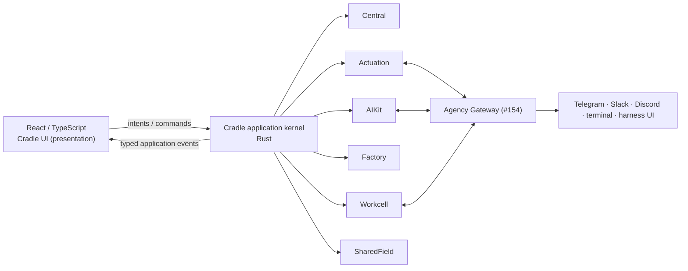

# 02 — Cradle architecture

**Status:** architecture commitment for the O:I desktop.
**Companion:** [founding positions](../../ProjectCentral/docs/0-ground/positions/FOUNDING-POSITIONS.md) and the [DLW manual](../../ProjectCentral/docs/1-vision/dlw/DLW.md) (intent), the [stories](../experience/STORIES.md) and [LOCAL-CAMPAIGN.md](../experience/LOCAL-CAMPAIGN.md) (the states, in its §0.5, and evidence).

**20 September 2026 clarification:** §6 explicitly includes retained kernel loading/resource state. Read [Wiki/constellation decisions WC01–WC15](../../ProjectCentral/docs/0-ground/positions/WIKI-CONSTELLATION-PRACTICE.md) and the joined development map (retired 27 Oct into the DLW map, O-I #706; read it at `8873b0968`) for its purpose and application. The dated implementation disposition in §11 remains historical evidence, not a finding about the owner's incoming local mains.

## 1. Stack and kernel

Tauri + Rust + React/TypeScript. React sits on top of a **real O:I application
kernel** — a small set of coarse application services composing the native
products — rather than on dozens of widget-scoped read-model calls. The renderer is a deterministic
projection of kernel events, and every human intent becomes a native operation
through the kernel.



## 2. The kernel is the current constitution of the environment

The kernel is not another database containing copies of everything. It is the
**current constitution of the environment** — what #158 calls the composition,
read as inhabitation:

```rust
Cradle {
    world: WorldRef,                    // Central ground + recognised machines
    project: Option<ProjectRef>,
    focus: Option<SubjectRef>,          // the one global subject (§7)
    journey: Option<JourneyRef>,        // active structured development, if any

    session_space: SessionSpaceRef,     // AIKit working environment
    agencies: Vec<AgencyPresence>,      // who is present (Gateway-informed)
    agent_sessions: Vec<AgentSessionPresence>,

    surfaces: SurfaceLayout,            // composed surface bindings (§8)
    attention: AttentionState,          // what requires the human
    composition: EffectiveComposition,  // products present / degraded / absent
    material: MaterialSituation,        // Workcell: bodies, services, placement
}
```

Composition asks what is constituted together; inhabitation asks what that
constitution means for the situated human and Agencies — the kernel answers
both, and the UI renders the answer.

## 3. Coarse application services

Ten services, not one command per widget. The first six **compose native
products**; the last four genuinely belong to the application whole.

| Service | Composes | Owns |
|---|---|---|
| `WorldService` | Central (`ctrl`), oi recognition | The first-class authored World (`WorldRef` tree with source treatment), Ground, Work files, machine/install recognition — read as a **selected Projection** (selection ≠ readability; omission by default), never as a profile database |
| `AgencyService` | Actuation, AIKit sessions, Gateway #154 | Agencies, AgentSessions, activity, encounter continuity |
| `KnowledgeService` | AIKit knowledge, Central | Search, semantic neighbourhoods, disclosure receipts, remember-this |
| `DevelopmentService` | Factory | Journeys, Runs, Candidates, Evidence, Recognition |
| `MaterialService` | Workcell | Material bodies, services, placement, bindings |
| `SharedFieldService` | shared-field contracts | Projections, participants, contributions, encounters |
| `SurfaceService` | — (application) | Surface registry, bindings, promotion/detach, layout |
| `ActionRouter` | — (application) | Intent → owner Action dispatch, authority gates |
| `SearchService` | — (application) | The one command/search aggregator over native descriptors |
| `AttentionService` | — (application) | Activity → Notification → Attention altitudes |

## 4. The integration ladder

Where a product exposes a clean Rust crate, use it in-process. Where it is
independently executable, use its stable CLI/application protocol. Where it is
persistent/networked, use its service protocol. **The renderer does not care.**

```text
React intent
  ↓
kernel service operation
  ↓
Rust adapter
  ├── in-process crate API        (factory, aikit-core/store today)
  ├── native CLI protocol         (ctrl, aikit, actuation, factory, workcell, ql)
  ├── local IPC / stdio           (ACP agent sessions, Gateway UDS)
  └── service / network API       (Gateway WebSocket, hosted SharedField)
```

This lets moving-but-stable product heads keep moving without binding the UI to
their internals. Every adaptation is honest at the UI: which seam served a
reading is disclosed (see the provider-truth law, §10).

## 5. Commands and events

```text
COMMANDS (human and agent intent)              EVENTS (kernel → renderer)
open subject                ◀────────────────  FocusChanged
execute Action              ◀────────────────  WorldChanged
edit / save / author        ◀────────────────  SourceChanged
send / address / interrupt  ◀────────────────  ActivityUpdated · SessionChanged
stage composition           ◀────────────────  KnowledgeChanged
resolve Attention           ◀────────────────  AttentionRaised · AttentionResolved
compose projection          ◀────────────────  RunChanged · JourneyChanged
create Agent from intent    ◀────────────────  MaterialChanged · CompositionChanged
                                             SharedFieldChanged
```

The key loop: **native operation returns → kernel state changes → typed events
→ React projection re-renders reality.** No optimistic fake mutation followed by
a "saved" card. Push, not poll: the current build's absence of any event seam is
the single largest infrastructure gap (§11).

## 6. Three state responsibilities — native work, retained resources, presentation

**Owner-directed clarification, 20 September 2026.** The earlier two-layer
account distinguished semantic authority from presentation correctly but did
not name the kernel's loading/resource continuity responsibility. It must not
be read as a prohibition on caching. The existing third-layer implementation
and [workspace continuity](02-ARCHITECTURE.md) are the
reconciliation targets; this is not a fourth store or framework migration.

**Semantic/application state** belongs to its kernel or native owner: World,
Project, Source, Knowledge, Agency, AgentSession, Journey, Run, SharedField,
Activity, Attention, material state, Action results, and the existing native
constellation/Expression work. Authoritative identity, source revisions,
permissions and durable semantic mutation stay there.

**Retained kernel loading/resource state** keeps the working readings available
above disposable views: source and directory readings, knowledge adjacency and
index projections, shared working-model handles, request generations,
in-flight deduplication, revision/currentness, per-provider availability and
subscriptions. It composes and caches owner readings; it does not become a
second authoritative Wiki, filesystem, session or Scene database. Existing
kernel source buffers remain the single editable model where already owned.
An adapter which is not a store may still consume this retained state.

**Presentation state** belongs to the desktop: open Surface bindings, split
arrangement, panel widths, resting/summoned regions, drawer, focused
presentation, scroll/camera, graph filters/expansion, popovers and view
checkpoints. Drafts and working models survive view disposal through their
existing shared owner/model path, not isolated competing copies in each view.

The responsibilities cooperate:

```text
native owner / application work + revision and authority
                        ↓ readings / receipts / invalidation
retained kernel resources + shared models + in-flight work
                        ↓ targeted subscriptions / usable partial readings
presentation bindings + live views + restorable checkpoints
```

Rules:

1. Never derive semantic truth or authority from presentation coordinates,
   cache presence or a restored view. Deliberate semantic authoring still uses
   the real owner Action; the ownership rule does not make Technè read-only.
2. Presentation is real product state: persisted, versioned and restorable.
   Resource retention is also legitimate product infrastructure. Neither is
   made unimportant by not owning source truth.
3. Semantic focus remains kernel-owned (§7). Layout checkpoints may retain a
   reference needed to restore that focus, but do not create a second focus
   authority or silently disclose the selected source to an agent.
4. Resource keys include native World/owner/ref, operation/query, revision or
   version basis and access/provider epoch. Equivalent authorised reads share
   work. Dirty models, stale responses and revoked access receive explicit
   treatment; a cache hit is not a fresh permission grant.
5. Independent local readings may be presented while another provider is slow
   or absent. Keep partial/completeness and per-owner revision basis visible.
   Save operations bind the coherent basis they actually require; no global
   revision or distributed transaction is fabricated.
6. Warm return does not cold-read files, re-enumerate the tree or reconstruct
   unchanged formations solely because visibility changed. Restart restores
   useful permitted models/checkpoints and then reconciles their currentness.
7. Native receipts/change observations invalidate affected resources. Preserve
   write ordering, bounded concurrency and subscribers; update only affected
   consumers. A no-cache comment in old code is an implementation decision to
   revise, not a constitutional prohibition.

Live-view retention, resource/model continuity and durable recovery are the
three cooperating continuity mechanisms, not replacement names for these
ownership responsibilities. Likewise, source field/constellation organisation
and Expressions/Technè are semantic and application-mode distinctions, not
state-layer classifications. [Wiki/constellation specification §9](WIKI-CONSTELLATION-SPEC.md#9-kernel-loadingresource-state-and-performance)
gives the concrete read, invalidation and performance contract.

### 6.1 The continuity law

**An open workspace is a durable set of bindings and working states. Changing its visibility changes presentation and resource use; it does not recreate the work.**

Implement three cooperating mechanisms:

1. **Live retention:** preserve suitable existing view instances for rapid return within a running application.
2. **Resource/model continuity:** retain file readings, directory listings and working models outside disposable view components.
3. **Durable recovery:** checkpoint the workspace and recoverable working state so a new process can reconstruct the useful workspace without rediscovering its tree first.

None substitutes for the others. Retained DOM does not survive process exit. A stored tab label is not recovered writing. A cache hit is not a current grant of authority.

Logical membership, runtime residency and resource readiness remain independent:

```text
Logical membership: open | closed
Runtime residency:  active | retained | released
Resource reading:   absent | loading | ready | refreshing | failed
Additional facts:   revision, stale, dirty, conflict, permission, availability
```

An open surface may be released from memory and still be open in the saved workspace. A retained surface may hold stale data. An active surface may show a recoverable error. Use a tagged implementation that prevents impossible combinations; these labels define responsibilities, not a mandatory giant union or another semantic store.

Leaving a mode, switching a workspace, hiding a native window, closing a tab and quitting the application are different transitions. App quit checkpoints open membership. Explicit tab close changes membership and applies the existing dirty-work policy. Runtime eviction changes neither membership nor canonical work.

### 6.2 Ownership, storage and identity

Keep the existing product/kernel authority. Central/source owners retain canonical files, revisions, history and mutation rules. Native session/process owners retain AgentSession, Run and terminal identity. Existing kernel source buffers remain the editable models where they already exist.

The shell owns workspace presentation, bindings and residency policy. For ordinary file drafts currently held by the shell, move the working model out of FileSurface's component lifetime into a shared model adapter; do not introduce a competing buffer for a source already owned by the kernel. The same adapter exposes reading, dirty basis, persistence health and permitted operations to both editor and preview.

A resource broker is a bounded projection/cache around existing readers, not a new filesystem service. Its lifetime is above the switching workspace/mode/pane subtrees. It should share identical authorized reads and notify only the consumers of the changed key. Heavy full-snapshot recomputation and rerendering of unrelated surfaces are measured and removed where demonstrated.

The workspace book stores arrangement, tab/split membership, stable bindings and view checkpoints. Large content, listing snapshots and draft journals are stored separately by reference. References to owner objects are not copies of owner identity or authority.

#### Identity rules

Use existing SurfaceBinding IDs and native refs. Maintain the distinction between:

- the native subject or source being read;
- the particular surface/view of that subject;
- the pane or arrangement currently presenting that view;
- the native window hosting the runtime instance.

Moving a surface changes placement, not its subject or identity. Multiple intentional views can share a document model while retaining independent caret/scroll/zoom. Arrangements refer to the same bindings rather than cloning buffers or conversations. A pending open records its originating workspace, pane, subject and intent generation before its first await; late completion cannot open into whichever workspace happens to be current later.

Workspace scope governs presentation and cache leases. Resource keys additionally carry the native owner/World or workcell scope, canonical ref or validated location, operation/format, revision selector and access/transport epoch. Path alone and workspace ID alone are insufficient identity keys. A current-revision pointer and an immutable revision reading are separate records. Do not deduplicate across different access scopes.

Machine-local layout and provider locations are not automatically portable between Mac and Omarchy. Rebind through existing owner/provider locators when crossing machines; preserve the local cached reading as allowed without treating an old absolute path as current authority.

### 6.3 The fast open and restore path

```text
User selects a file, or saved workspace supplies its binding
                 |
       acknowledge the exact destination immediately
                 |
       resolve shared model / resident view / cached reading
                 |
       reveal or reconstruct the requested surface
                 |
       validate through its owner and reconcile revisions

Directory restoration and refresh run alongside this path.
They are not prerequisites for opening a known binding.
```

A warm return to an unchanged resident surface performs no file-content read, tree enumeration, iframe navigation, terminal spawn or scene reconstruction merely because visibility changed. Background revalidation may run independently when stale policy requires it.

A released-but-open surface reconstructs from its retained model and checkpoint. A process restart paints the workspace structure and visible requested surfaces first, then restores the navigator from its own snapshot and revalidates appropriate directories. Inactive tabs remain logically open without all being eagerly mounted, executed or read.

A cold file open shares a single owner-mediated acquisition across admission, model and renderer. The inspected code explains that SurfaceOpen requires a reference registered by an owner-mediated read. Preserve that rule. Before admission completes, the UI can display a pending presentation binding; it must not pretend native admission succeeded. Once admitted, hand the obtained reading to the renderer instead of discarding it and issuing the same acquisition again.

Prefer an already known binding before starting another file read. On a new runtime epoch, re-establish native admission through the existing owner route. Retained presentation data never manufactures registration or write capability.

For native HTML, trace both text inspection and `oi-material` delivery. The model's declared revision and the actual rendered bytes must agree. Prefer reuse of the authorized acquired revision, or a revision-bound material request if the existing protocol cannot express that. A metadata read followed by a latest-by-path navigation must not silently claim that two different revisions are one. Count physical owner acquisitions separately from necessary IPC/renderer delivery.

A ten-second injected directory-list delay must not hold back a known file's pending tab, resident return or independent direct file read. Minimal native admission and access checks remain allowed dependencies. If native locking still serializes unrelated directory I/O ahead of that file, the measured blocking span belongs in the same work package.

### 6.4 Resource cache and coherence

Use one shared broker interface with distinct file/model and directory entries. Each entry tracks the authorized key, revision or generation, last usable value, validation state, in-flight work and subscribers. Concurrent equivalent reads join one in-flight acquisition. Cancellation releases a caller's interest; it does not cancel a shared read that another live consumer still needs.

Priority is visible requested content first, user-requested folder expansions next, background restoration last. Bound concurrency and prevent starvation. Preserve causal native write ordering and same-document read/write sequencing. Do not replace KernelProvider's serialization with unrestricted Promise.all without proving the owner and merge contracts support it.

Directory expansion consumes cached data synchronously. Store expansion, selection, scroll and filter state independently of the listing. Collapsed row DOM can unmount. For large trees, render the visible rows with appropriate keyboard and accessibility semantics; do not keep an ever-growing hidden DOM tree just to retain listing data.

Fresh results update the exact subject entry. On refresh failure, keep an allowed last listing visible with a local error/retry indication. An empty successful directory, an unavailable directory and a directory not yet read are distinct states.

Receipts trigger targeted rereads or explicit validated deltas; they are not automatically complete new state. KernelProvider's source contract says receipts mean look again. Audit actual file/directory event coverage before wiring invalidation: `expression_changed` demonstrates an existing pattern, not a universal filesystem watcher. Cover app writes, agent/external writes, rename, delete, watcher overflow, transport reconnect and missed sequence ranges.

Where the existing receipt contract lacks coverage, add the narrow owner event/invalidation contract required or bounded reconciliation at the appropriate owner boundary. Do not add a kernel park/resume protocol merely for visual hiding. Conversely, do not declare the kernel untouchable if source admission, material revisions or change coverage demonstrably prevent correct continuity.

Each asynchronous result is checked against request generation, subject, originating workspace/view, owner epoch and revision basis before publication. A late older read cannot replace a newer receipt-derived revision or a dirty draft. Reconnect invalidates trust in stale capabilities; authentication/authorization changes partition or purge caches according to owner policy. Old reads are not silently relabelled current.

### 6.5 Runtime residency and resource budgets

Provide a surface-runtime registry above replaceable arrangement and pane trees, integrated with existing binding machinery. It retains stable per-window runtime handles and assigns visible slots to them. The registry is presentation infrastructure, not another source registry.

Each surface kind declares a lifecycle adapter: reveal, conceal, suspend supported presentation work, checkpoint recoverable state, restore, and dispose its view resources. Existing APIs should be adapted, not duplicated to satisfy these names.

`active` means presented and responsive. `retained` means a reusable view is held within a declared budget; suspension capability is separately recorded and verified. `released` means disposable runtime resources are freed after recoverable state is secured. An arbitrary embedded page that cannot suspend honestly remains a hidden live page until policy chooses release; never label CSS hiding as successful execution suspension.

Retain view-critical state without keeping every subscription live. Pause view animation, layout work, render loops, microphone/video work where appropriate and redundant presentation polling. Keep owner activity and the shared invalidation/model listeners alive as required. Hiding a Run view does not stop its Run. Hiding a terminal does not issue a process kill. An active context selection is a native ref plus revision/span checkpoint, not a retained DOM node.

Keep a bounded warm working set across workspace switches. Workspace partitioning prevents accidental state bleed; it does not require flushing all the outgoing workspace's caches. Evict expensive, clean, reconstructible least-recently-used views under declared count/byte/cost budgets. Dirty unrecoverable state, in-flight durable writes and uncheckpointed edits block destructive eviction. Failure to checkpoint is visible and leaves that state protected.

A stable React key only identifies a child within its reconciliation position. Changing ancestors or portal containers can still reconstruct it. Prove the placement strategy across tab moves, split changes, maximization and arrangements, including iframe navigation counters. A retained host must actually retain the browser document, not merely retain a descriptor for recreating it.

Native window detach is a cross-document boundary: preserve model and view checkpoint, transfer the existing native lease/identity where supported, and reconstruct the renderer in the receiving window. Do not promise to move a live DOM tree between processes or windows. Test that detach/redock neither duplicates an owner session nor loses its work.

### 6.6 HTML, Markdown and material continuity

HTML deserves an explicit adapter because it is both a document and potentially an executing application.

For a retained HTML view, preserve its iframe and stable revision-bound source. Do not assign `about:blank`, remove `srcDoc`, change the generation key or remove the frame merely to hide, revalidate or show progress. A revision change or explicit Reload is a separate replacement operation with a checkpoint and a new generation.

For controlled O:I/Day/Flow documents, extend the existing bounded page-host bridge with negotiated lifecycle/checkpoint support where missing. Validate sender window, per-instance token, expected generation, source/document revision and message schema. Preserve the opaque-origin sandbox and current authority restrictions. Do not add `allow-same-origin`, bridge access or broad DOM introspection as a performance workaround.

A controlled document may acknowledge ready, suspended and resumed states and serialize supported state such as scroll, selected section, document-local form fields and intended view. Define exactly which state each template can recover. An arbitrary third-party page has no universal safe JavaScript-heap checkpoint or host-controlled pause; use its supported capabilities, a bounded live-retention policy, or an honestly disclosed reconstruction. Never persist password or secret form fields indiscriminately.

Keep page fetch, renderer readiness and interaction readiness distinct. An iframe load event alone does not prove successful content or application initialization. Managed documents use a generation-checked ready handshake; other material formats use the strongest real host observation available and disclose uncertainty without an eternal blocking spinner.

Avoid reparsing or regenerating identical Markdown/HTML on unrelated shell changes. Cache pure rendering results by content revision plus renderer version, base-asset scope and relevant options. Source and Rendered views use the same current reading and working-model basis. Restore the person's selected view across remount/restart where supported, with safe fallback only when that view becomes unavailable. A source edit does not cause a live preview to silently overwrite or discard the draft.

Preserve the existing single Expression stage per native window. Page readiness does not wait for optional GPU effects. Stage timing cues accompany ordinary accessible loading status rather than controlling file admission or serving as proof of readiness.

### 6.7 Durable workspace and draft recovery

Preserve the actual v2 book and migration path. A workspace checkpoint includes membership, active arrangement, per-arrangement pane layouts, stable surface refs, selected tab/focus, widths/depths, view-kind checkpoints, navigator state, pinned context and native-window placement where supported. Content and draft records remain separately referenced. Avoid persisting derivable whole-world snapshots or duplicate owner state.

Use an asynchronous, coalesced persistence writer behind the existing workspace interface. Keep a short bounded write interval and a maximum dirty age; flush on meaningful navigation and application lifecycle events where available. Lifecycle flushes are additional protection, never the only chance to save. Expensive full-book serialization must leave typing, scrolling and resize hot paths. A debounce alone does not make a synchronous write nonblocking; measure and choose the existing native/transactional storage seam or an appropriate asynchronous presentation store.

Maintain atomic publication and a last-known-good checkpoint. Preserve originals before migration. Draft journaling/checkpoint acknowledgement is distinct from canonical file save. The interface differentiates unsaved edits retained on this device from edits not yet durably retained. Define and test the crash-loss bound for unacknowledged edits; every acknowledged durable draft revision must survive the supported crash/restart test. Do not claim arbitrary last-keystroke durability without the corresponding acknowledgement mechanism.

Recovery is progressive: decode the envelope, recover independently valid workspaces, then valid bindings and view checkpoints within each workspace. A damaged view checkpoint need not discard its file binding. A damaged binding need not discard sibling tabs. Keep invalid original bytes or records in quarantine with a reason and an inspect/recover/export route. A small nonblocking notice identifies the affected workspace; an empty replacement is not silently saved over its only copy.

For malformed whole-book JSON or interrupted persistence, use the last committed snapshot and separately retained original bytes. Unknown future schema versions are protected rather than force-decoded or downgraded. Invalid active selection chooses a valid surviving workspace while retaining the diagnostic. Storage-full and migration-failure paths cannot overwrite good data with fallback emptiness.

Resolve multiwindow writes through one authoritative writer or versioned compare-and-swap/reconciliation at the existing persistence boundary. Per-window checkpoints carry their originating workspace/surface. Last-writer-wins replacement of an old entire book is insufficient when another window has changed tabs or drafts.

A process restart rebuilds the view; it does not resurrect its old DOM. Restore supported scroll/selection only once the correct content revision and renderer are ready, and only while the user has not superseded that restoration by acting. Undo history survives a remount through the held editor model; cross-process undo is promised only for an explicitly serialized and tested format. Native processes reconnect when their owner still holds them; an unavailable process is shown as disconnected/exited, not silently respawned as the same session.

### 6.8 Loading and error states

Use per-surface error boundaries so one renderer failure cannot blank the workbench. Preserve hidden-view keyboard/focus isolation, useful status announcements and reduced-motion behavior. Scope loading cues by operation and surface so mounting several directory rows does not broadcast a global loading storm. Local status is sufficient: no new context/participant modal or full-screen application blockade.

## 7. One global focus model

The whole application shares one notion of *what we are currently talking
about* — a stable `SubjectRef` plus its surrounding relations:

```text
Current World · Current Project · Current Focus (SubjectRef)
Current Journey · Current Agency encounter
```

Selecting `src/project.rs` yields `SubjectRef = Central source ref`,
`ProjectRef`, `WorldRef`. From that one relation: the canvas opens the editor;
knowledge shows its neighbourhood; the Cradle addresses an agent about *that
exact subject*; Factory shows Runs touching it; history shows change; search
recentres; SharedField can project it if eligible. No component copies selection
state independently. This is the backbone of human/agent co-reference: an agent
receives refs to selected subjects, never pasted screen text.

Focus changes propagate as events (§5). Focus is semantic state — kernel-owned,
not a UI store.

## 8. Tabs are Surface bindings

A tab is not a page URL. It is:

```text
SurfaceBinding {
    surface_ref      // which presentation
    subject_ref      // which subject it shows
    provider         // which service/product supplies it
    region           // centre · left · summoned · drawer · detached
    presentation     // mode (read/edit/graph/…)
    local_state      // view checkpoint; shared dirty model remains above the view (§6)
}
```

The same binding can move: centre tab → split; summoned aperture → centre
panel; centre surface → detached window; detached Observatory → back into the
left field. Same subject, same binding, different area and region. Bindings are
presentation identity, non-canonical; the *subject* is canonical and
native-owned.

## 9. Product seams — the four-part contract

Every native product already converges on the same integration shape; the
kernel consumes them uniformly:

1. **Capabilities descriptor** — `ctrl action.list`, `factory capabilities`,
   `aikit` profile/context resolution, `actuation.cli/v1` surface descriptor,
   `ql capabilities`, Workcell SDK/wire.
2. **Read-model projection without mutation** — Factory `build-view/v1`,
   Central `personal.show`, AIKit effective-skill/context readings,
   Actuation `agency.read / realised.read / activity.read / stream.read`.
3. **Opaque client-owned refs** — Workcell `ExternalRef`, QL client subjects,
   Factory's preserved AIKit/Actuation/Workcell refs. No product re-owns
   another's nouns; the kernel treats them as opaque and routes by owner.
4. **Explicit authority gates on mutation** — Central CAS + `accepted_by_ref`
   proposals, Factory bounded Action grants, AIKit reviewable Procedures,
   Actuation recognition-before-mutation. The desktop adds no bypass: rich
   rendered code is never a privileged caller (§12).

The factory and architecture streams share these producer/consumer contracts. No terminal/provider business commands, grant issuance, private session store or material registry belongs in React.

## 10. Honesty laws (rendered, not implied)

- **Provider truth:** `live-provider → may claim live; fixture → Degraded;
  derived-only → Degraded`. The UI never upgrades a source class, anywhere in
  the application.
- **Absence is an observation, not a failure.** An uninstalled product, a
  stopped daemon, an unprojected skill, a missing version flag: rendered as
  what-is, never as error, never fabricated.
- **Degradation is local.** A provider disappearing degrades one reading; the
  SessionSpace and other relations keep their identity
  (`provider pane ≠ SurfaceRef ≠ SessionSpaceRef`).
- **Authority is visible.** An action discoverable is not an action authorised;
  the UI shows which authority stands behind each mutation.

## 11. Current build disposition (historical census, 4 September 2026)

This section preserves the implementation census at the date below. Its
"Mount", "Add" and "Retire" lists are not today's availability reading.
The build moved into `desktop/cradle/`; native event, encounter, document and
SharedField paths have since developed. Follow the [current architecture
navigation](../architecture/README.md) and each operation's named source/test
cut before treating a listed gap as still open. This census remains here so
earlier links and the reasons for the rebuild remain intelligible.

Evidence: `desktop/core`, `desktop/src-tauri/main.rs` (39 commands, zero
events), `desktop/ui/src` as of 2026-09-04.

**Keep and build on (real today):** the workbench host frame with tabs/splits/
regions/keyboard grammar (`workbench-host.tsx`); Flow authoring with CAS
revision conflict; AgentProfile CRUD over `ctrl`; Knowledge
search/read/relations/explain/history; real ACP agent conversation with
canonical AgentSession identity; Factory bounded Action dispatch;
SessionSpace focus.

**Mount (written, tested, unreachable):** participant composer (To:/@
addressing, `participant-composer-model.mjs`); the full session observatory /
activity / notification / attention model (`session-observatory-model.mjs`);
the real Factory `BuildSurface` body in place of the summary cards now rendered.

**Add (the load-bearing gaps):** the event seam (Tauri channel + native change
sources); global focus events and subject-scoped read models; streaming and
concurrent ACP sessions with mid-turn interrupt; the Actuation payload adapter
(`agency.read`/`activity.read`/`stream.read` → kernel); intent-created Agent
resolution (AIKit AgentProfile + compose + Workcell placement as one flow);
Journey/Run readings from Factory; live World/file editing through Central
owner-Actions; the Agency Gateway integration for cross-surface continuity.

**Retire/replace:** the static System constitution table → live composition
reading (what is present/degraded/absent, from recognition + capability
descriptors); descriptor cards for region surfaces → real region renderers;
env-var JSON handoffs → kernel services (the handoff files were honest scaffolding);
Explore stays read-only until SharedField has a live substrate — the desktop
must not simulate one.

## 12. Security boundary

`rendered UI → named kernel commands → BridgePolicy → native operation`. No
generic shell, filesystem, process, network or secret bridge; the capability
grant remains `core:default`; contribution code is never the authorising
caller. What the kernel may do on the human's behalf runs through the owner
products' own authority gates (§9.4), surfaced as visible grants, never as
ambient power.

## 13. Omarchy and the larger host (#158/#159)

The kernel's composition is scope-neutral: the same inhabitation reading serves
the desktop on macOS, and the Omarchy reference World where the desktop is an
integral Quickshell-composed constituent of the host shell. The desktop owns the
whole application experience; Omarchy owns shell config, plugin discovery and
hot-reload; neither imports the other's identity (`file presence ≠ activation`;
`tmux pane ≠ SurfaceRef`; `Quickshell widget ≠ Surface`). Adaptive bootstrap
(`oi host omarchy plan|realise|verify`) is World recognition, not installation
of a foreign app.


O:I #159 handles native Omarchy entry/focus/attention. Provider-bound window keys, panel/tray and desktop should open the exact canonical subject. Hyprland permission denial is a negotiated operation failure, not a new philosophical ban on automation or reason to bypass the compositor. Preserve authorised visible control, keyboard/pointer and the host's actual permission model.

## 14. Agency Gateway desktop consumer contract

Owner-directed desktop clarification,2026-09-06. Native specification remains
[O-I #154](https://github.com/EpiLogos/O-I/issues/154); this section gives its
existing architecture placement (§1/§3/§4) an explicit consumer boundary. The
product team develops the Gateway/connector/Stream/hosting implementation.
Execution units GW-01–06 live in
[the programme](../../.superpowers/sdd/cradle-rebuild/IMPLEMENTATION-PROGRAMME-2026-09-06.md#agency-gateway-desktop-integration--explicit-dependency-track).

`AgencyService` consumes AIKit's authorised ecology and native Gateway client
through S's declared integration route. Use the product protocol/SDK and its
negotiated local/network carrier; no renderer-owned websocket protocol or second
connector/session registry. The desktop owns view binding, attention and focus,
not Agency, AgentSession, ActuationStream or connector identity. Workcell owns
service/Fabric materiality; Actuation owns attributable Stream and authority.

| Owner input, where supplied and authorised | Desktop projection |
|---|---|
| SessionSpace, Agency/Agent, AgentSession, purpose and Focus | Existing-session selection and agent details in the dynamic right panel; selection attaches the actual owner session |
| Actuation/ActuationStream, sequence/cursor, attribution/locus, native evidence and Return refs | Conversation and semantic Activity over the same encounter; ordered incremental reading/replay with native correlation intact |
| Operative Context, resolved Harness/model condition, context revision/lineage | Context and Inspect planes; authored, effective and actually active facts remain distinct |
| Surface, connection, reachability, material observation, compatibility and age | Side/full/tab/detached/Observatory views with exact serving seam and local degraded/last-observed state |
| Available/granted capabilities and permitted invocation modes | Owner-disclosed operations with exact scope/refusal; presence and reachability never imply authority |

One canonical encounter retains one transcript, draft/composer and native session
across presentations. ActuationStream is the semantic event source for Gateway
integration; native provider traces/exposed thinking retain their richer content
and attribution. ACP connection events alone do not establish canonical Stream
or cross-surface Gateway acceptance. Preserve bounded retention/backpressure and
durable owner replay; a replay gap or unsupported operation is not repaired with
fabricated events. Continue/refine/fork/recompose are explicit owner relations.

A session bridge that is slow, blocked or stopped degrades its own encounter's
reading; it never blocks the rest of the application. Observing a session is a
relation its owner grants, never ambient: listing or reaching a session does not
open its conversation, Activity or context to another participant or Surface.
Recorded conversation, prepared operative context and the provider's retained
continuation state are separate. A transcript on disk does not prove it entered
the new acting context. Compaction retains source range/producer, required
identity/governance, pins, unanswered requests and arrivals across its committed
cursor. Native resume, selected-context rehydration and a fresh attempt are
named distinctly. No hidden reasoning capture is required.

A disappearing UI consumer detaches its view; it does not cancel the provider or
Gateway. Explicit cancel is a separate owner operation. Provider conversation IDs,
transport credentials, sockets/hosts and Fabric addresses never become canonical
AgentSession identity. Fabric admission, Gateway scopes, AIKit capabilities,
Actuation bounds and native Action authority remain separate.

Until a compatible native ecology/attach operation is available, disclose the
missing seam and affected reachability. Local sources/wiki/workspaces remain
usable. Reuse the existing resident encounter only with its truthful local scope;
never call it the Gateway, introduce another persistent desktop encounter owner,
or replace an active provider to force an upgrade. A subsequent owner-supported
binding/migration must prove preserved identity and history explicitly.
